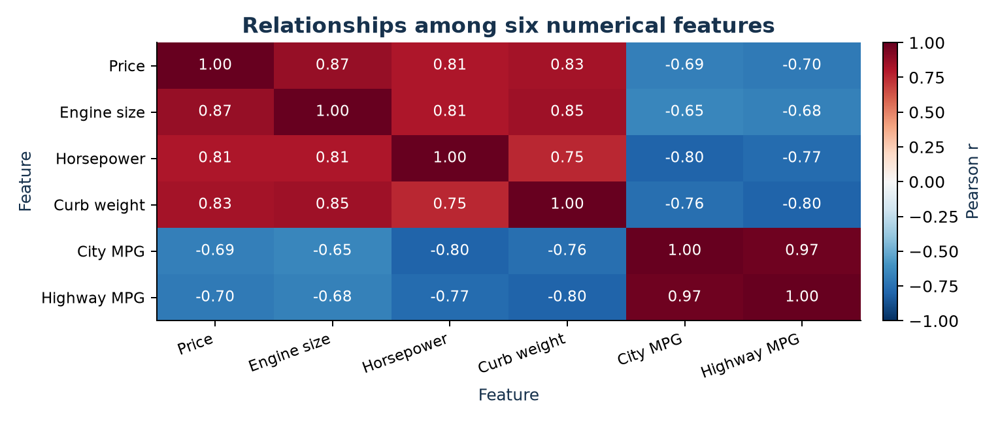

# Cars Exploratory Data Analysis

**Minor project | Padmavari Aditya | Batch: AI**

A complete, reproducible exploratory analysis of the UCI Automobile dataset.
One Python file loads and audits the data, cleans it, calculates statistics,
generates eight charts, and builds an eight-page PDF report.

[Read the project report](output/Padmavari_Aditya_Cars_EDA_Report.pdf) ·
[Read the findings and chart observations](output/findings.md) ·
[View the source code](Padmavari_Aditya_Cars_EDA_Project.py)



## Run the project

Verified with **Python 3.12.14**. Python 3.12 is the reproducible target;
dependencies are pinned to the versions used for the successful run.

On Windows, after installing Python 3.12:

```powershell
git clone https://github.com/Adityaabhi14/cars-eda-minor-project.git
cd cars-eda-minor-project
py -3.12 -m venv .venv
.\.venv\Scripts\python.exe -m pip install -r requirements-lock.txt
.\.venv\Scripts\python.exe Padmavari_Aditya_Cars_EDA_Project.py --self-test
.\.venv\Scripts\python.exe Padmavari_Aditya_Cars_EDA_Project.py --report-date 2026-11-19
```

In the existing project workspace, the environment is already installed. Run:

```powershell
.\.venv\Scripts\python.exe Padmavari_Aditya_Cars_EDA_Project.py
```

On Linux or macOS with Python 3.12 installed:

```bash
python3.12 -m venv .venv
.venv/bin/python -m pip install -r requirements-lock.txt
.venv/bin/python Padmavari_Aditya_Cars_EDA_Project.py --self-test
.venv/bin/python Padmavari_Aditya_Cars_EDA_Project.py --report-date 2026-11-19
```

The original dataset is included, so the normal run works **offline after
dependency installation**. If only the standalone Python submission file is
available, it downloads the original UCI data over HTTPS and checks its SHA-256.
That first standalone run requires internet access. It never needs an API key.

Optional settings:

```powershell
.\.venv\Scripts\python.exe Padmavari_Aditya_Cars_EDA_Project.py --student "Padmavari Aditya" --batch "AI" --report-date 2026-11-19 --output-dir output
```

`--data path/to/imports-85.data` accepts an alternative local copy in the same
headerless 26-column UCI schema. The analysis and narrative are designed for
the referenced Automobile dataset, rather than arbitrary cars CSV files.

## Dataset and research questions

[Automobile, UCI Machine Learning Repository](https://archive.ics.uci.edu/dataset/10/automobile)
contains **205 records and 26 original columns**, including price. It combines
1985 automobile specifications with insurance information. The original
dictionary is included as `data/imports-85.names`.

The analysis asks:

1. How are prices distributed, and which values are unusual?
2. Which makes, fuel types, and body styles are represented?
3. How do engine size, horsepower, weight, and fuel economy relate?
4. How do prices compare across body styles and adequately represented makes?

Prices and dimensions without explicit units in the dictionary are labelled
**source units**. No currency conversion or inflation adjustment is performed.
MPG is fuel economy, not odometer distance. Vehicle age and transmission cannot
be analysed because those columns are absent.

## Cleaning decisions

- Preserve the source file and read all fields as strings before parsing.
- Interpret `?` and blank/null-like tokens as missing. The source has **59
  missing cells** across seven columns.
- Normalize whitespace and case. Correct the make labels `alfa-romero` to
  `alfa-romeo` and `peugot` to `peugeot`, recording the affected counts.
- Parse 18 numerical columns, including nullable integer door and cylinder
  counts. Keep the ordinal interpretation of `symboling` explicit.
- Check numerical conversion failures, impossible values, and exact duplicates.
  The source has **zero exact duplicate rows**, and none are removed.
- Leave numerical missing values unimputed. Category summaries use all 205
  records; price analyses use 201 known prices; horsepower/highway-MPG analysis
  uses 203 complete pairs. Correlation sample sizes are exported for every pair.
- Flag outliers using `Q1 - 1.5 × IQR` and `Q3 + 1.5 × IQR`. Retain plausible
  luxury/performance vehicles. Fourteen prices are flagged; flags are not proof
  of erroneous observations.

Cleaning retains **205 rows × 26 columns**. The pipeline exports missing-value
counts before and after, category frequencies, schema and types, descriptive
statistics for all numerical and categorical fields, group comparisons, and
outlier records with source-row references.

## Results

All figures below are calculated by the submitted code:

| Finding | Evidence |
| --- | --- |
| Prices are right-skewed | Mean 13,207; median 10,295; skewness 1.81; n = 201 |
| Toyota is the most represented make | 32/205 records, or 15.6% |
| Fuel groups are imbalanced | 185 gas and 20 diesel records |
| Engine size is positively associated with price | Pearson r = 0.872; n = 201 |
| Horsepower is negatively associated with highway MPG | Pearson r = -0.771; n = 203 |
| Mercedes-Benz has the highest eligible make mean | Mean 33,647; n = 8; only makes with at least 5 prices compared |
| Some prices are unusually high under the IQR rule | 14/201 flagged; all retained |

Eight charts cover five chart types: histogram, bar, box, scatter, and heatmap.
Each has a title, labelled axes, and a written observation in the report and
`output/findings.md`. Fuel-coloured scatter plots add a third variable to the
relationship analysis.

These are associations in a small historical collection. Unequal group sizes,
missing measurements, and overlapping vehicle characteristics limit the
conclusions. Sample counts are not market share, and correlations are not
causal estimates.

## Files and submission

```text
Padmavari_Aditya_Cars_EDA_Project.py   All loading, cleaning, EDA, charts, tests, and PDF code
requirements.txt                    Pinned direct dependencies
requirements-lock.txt               Exact verified environment
data/imports-85.data                Unmodified original source data
data/imports-85.names               Original source dictionary
data/README.md                      Source attribution, license, and checksums
output/Padmavari_Aditya_Cars_EDA_Report.pdf
output/charts/                      Eight chart PNG files
output/tables/                      Audit, statistics, groups, and cleaned data
output/analysis_summary.json         Run metadata, quality checks, findings, and correlations
output/verification.json             Generated-output verification result
output/findings.md                   Findings and chart observations
submission/                         Created locally; ignored by Git
```

The assignment submission is **exactly these two files**, copied automatically
into `submission/` after a successful run:

1. `Padmavari_Aditya_Cars_EDA_Project.py`
2. `Padmavari_Aditya_Cars_EDA_Report.pdf`

The GitHub repository includes supporting data and reproducibility materials.
The original assignment PDF is not redistributed. The generated report contains
analysis and explanations, rather than a full code listing.

## Verification

`--self-test` runs six meaningful cleaning checks: normalization before duplicate
detection, retaining records with missing prices, count parsing and label
corrections, rejecting impossible/nonfinite values, preserving plausible
extremes, and rejecting an invalid schema.

Every normal run also verifies the cleaned schema, duplicate status, finite
observed numerical values, chart files and observations, exactly eight PDF
pages and eight embedded chart images, source attribution, and the analysis
denominators. `output/verification.json` records the result. The PDF pages were
rendered and visually inspected for the delivered report.

The GitHub Actions workflow reruns the tests and complete analysis on Python
3.12 on both Ubuntu and Windows.

## Explaining the project

Read the numbered sections in the single Python file in order:

1. Define the source, schema, and research questions.
2. `load_data` preserves raw missing markers; `clean_data` records each correction.
3. `analyse` calculates summaries, group comparisons, IQR flags, and correlations.
4. `create_charts` creates each chart and its data-derived observation.
5. `build_findings` and `export_results` preserve evidence for the conclusions.
6. `create_report` assembles the PDF from the same results and chart files.
7. `verify_outputs` and `CleaningTests` check the behaviour and final artefacts.

Be ready to explain why missing prices were not filled, why IQR flags were
retained, why analyses have different sample sizes, and why correlation does
not establish cause and effect.

## References and data license

Schlimmer, J. (1985). *Automobile* [Dataset]. UCI Machine Learning Repository.
[https://doi.org/10.24432/C5B01C](https://doi.org/10.24432/C5B01C).

The dataset is distributed under
[Creative Commons Attribution 4.0 International](https://creativecommons.org/licenses/by/4.0/).
The original data are unchanged; derived tables apply the documented cleaning
and analysis. See `data/README.md` for provenance and checksums.
