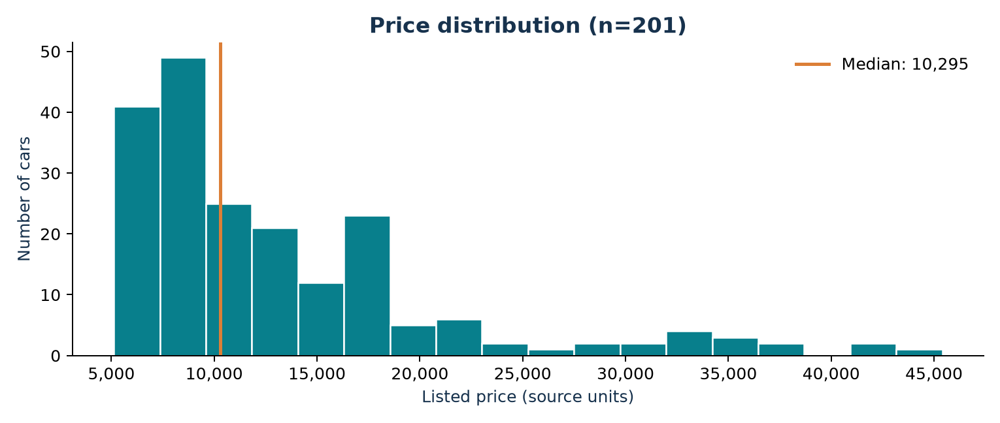
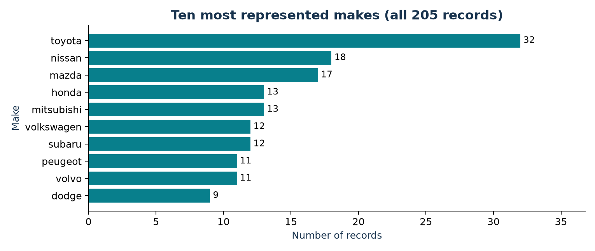
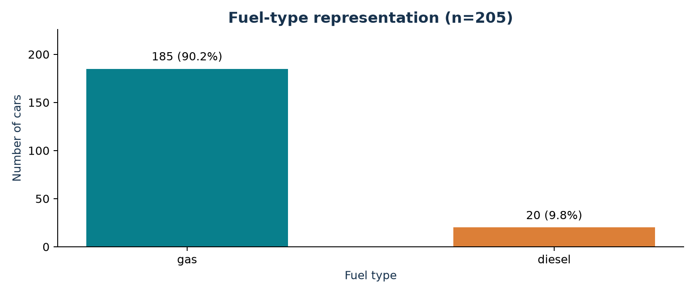
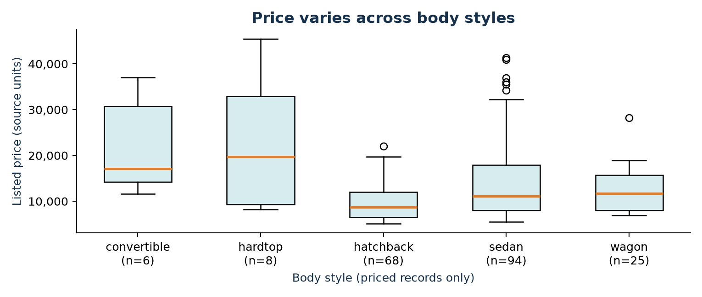
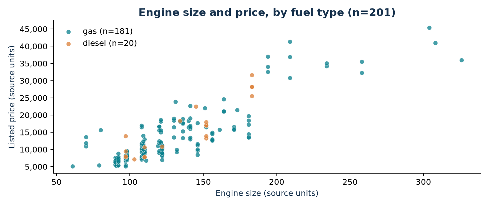
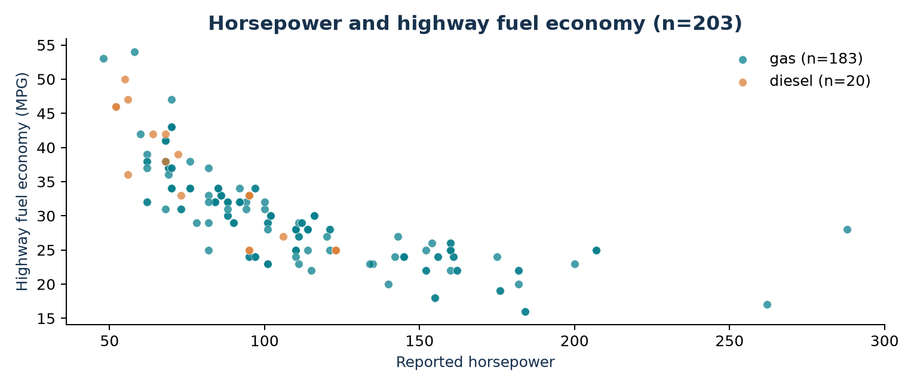
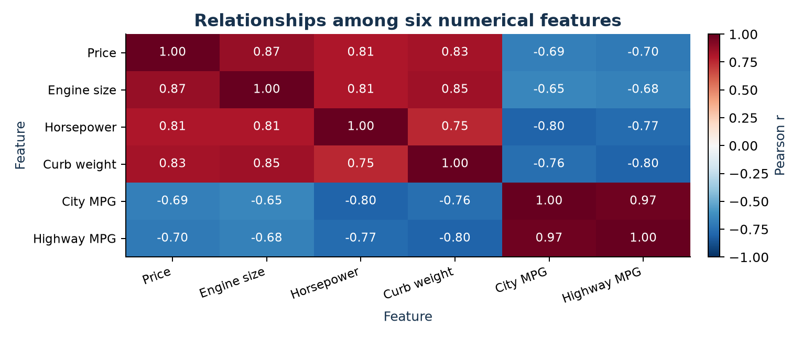
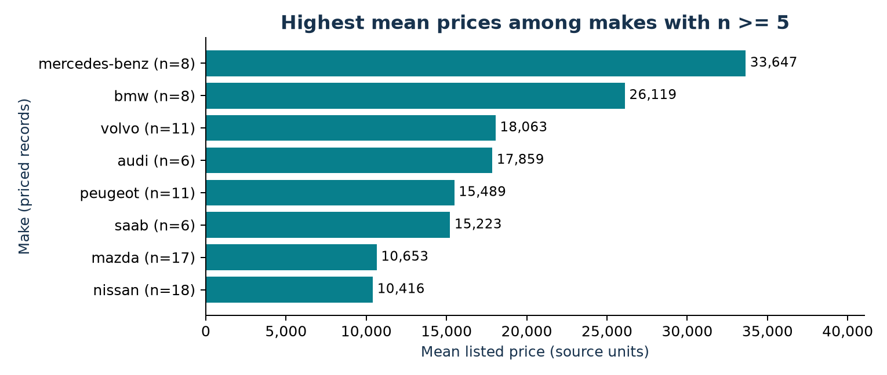

# Cars EDA findings

Student: Padmavari Aditya | Batch: AI

1. Prices are right-skewed: mean 13,207, median 10,295, skewness 1.81 across 201 known prices.
2. Toyota is the most represented make: 32/205 records (15.6%). This is sample composition, not market share.
3. The fuel mix is imbalanced: gas 185, diesel 20.
4. Larger engines are associated with higher prices: Pearson r=0.872 using 201 complete pairs.
5. Horsepower is negatively associated with highway MPG: Pearson r=-0.771 using 203 complete pairs.
6. mercedes-benz has the highest mean price among makes with at least five known prices: 33,647 (n=8).
7. The price IQR rule flags 14/201 records outside [-5,312, 29,588]. These observations are retained.

## Chart observations

### 1. Price distribution

The mean price is 13,207, compared with a median of 10,295; sample skewness is 1.81. The higher mean and long upper tail indicate right skew.

### 2. Most represented makes

Toyota contributes 32 of 205 records (15.6%). The dataset contains 22 makes; these counts describe dataset composition, not market share.

### 3. Fuel-type representation

gas: 185 records (90.2%); diesel: 20 records (9.8%). The imbalance limits comparisons between fuel groups.

### 4. Price by body style

Hardtop cars have the highest group median (19,688; n=8). Group sizes differ; the boxes show spread, and isolated points are IQR flags rather than proven errors.

### 5. Engine size, price, and fuel type

Engine size and price have Pearson r=0.872 across 201 complete pairs. Fuel colour adds a third variable; the pooled association does not isolate an engine-size effect or establish causation.

### 6. Horsepower and fuel economy

Horsepower and highway MPG have Pearson r=-0.771 (n=203). Higher-power cars tend to have lower fuel economy in this sample; MPG measures efficiency, not distance driven.

### 7. Numerical feature relationships

City and highway MPG are closely related (r=0.971). Cell sample sizes range from 199 to 205 because missing values are excluded pair by pair. Correlations involving similar measurements can be redundant.

### 8. Mean prices by make

Among makes with at least five priced records, mercedes-benz has the highest mean price (33,647; n=8). Only the top eight eligible makes are shown; the minimum count reduces very small-group comparisons but does not remove sampling bias.

## Limits

Historical, nonrandom sample; unequal group sizes; missing values use different denominators.
No vehicle age, transmission, odometer mileage, or inflation adjustment. Associations do not establish causation.

Source: Schlimmer, J. (1985). Automobile. UCI. https://doi.org/10.24432/C5B01C. CC BY 4.0.
